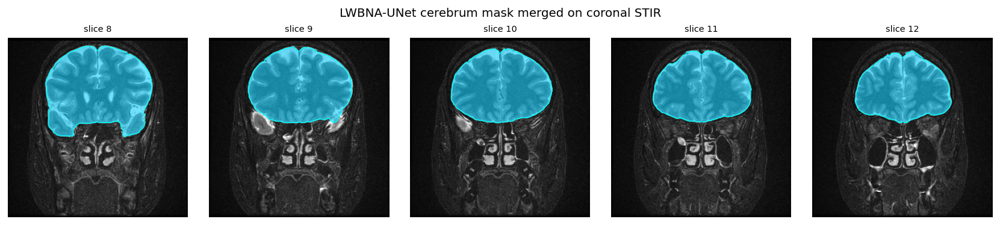
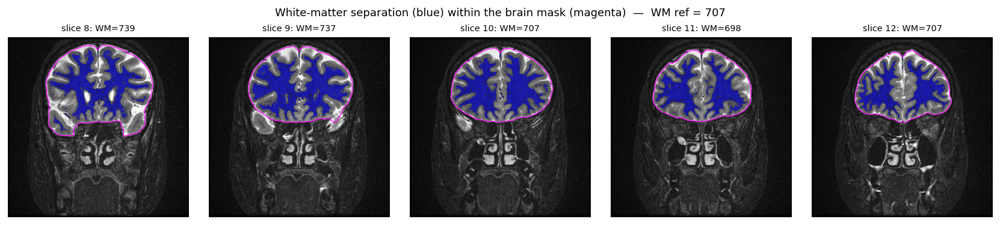
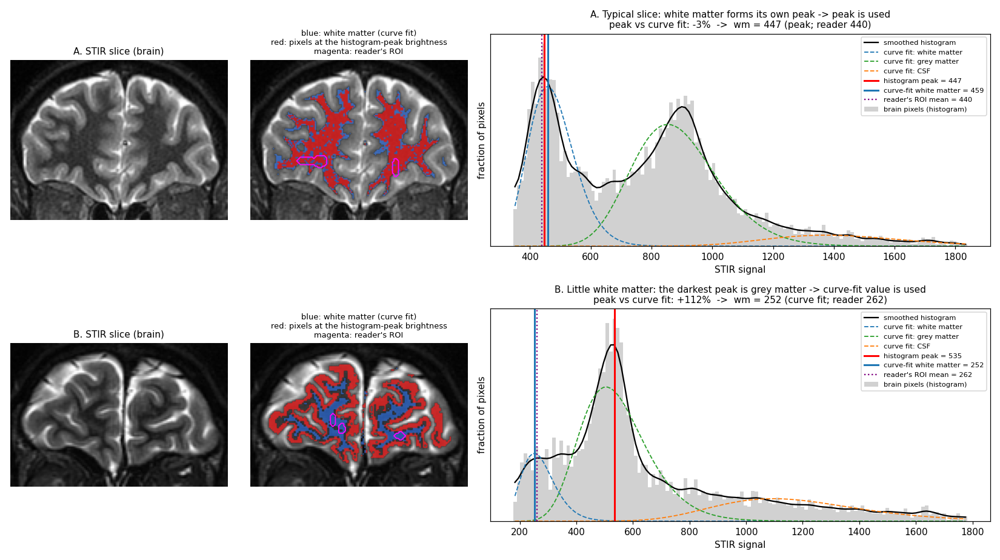

# MRI STIR Mapping — Orbital Signal Intensity Ratio (SIR) for Thyroid Eye Disease

Lightweight pipeline to compute the **orbital SIR map** on coronal **STIR** MRI for
grading inflammation in Thyroid Eye Disease (TED / Graves' orbitopathy).

The SIR (Higashiyama et al., *Jpn J Ophthalmol* 2015) normalises the orbital
signal by the **cerebral white matter**:

```
SIR = orbital STIR signal / brain white-matter STIR signal      (abnormal: SIR > 2.0)
```

The hard part is obtaining a clean **brain mask** to read the white-matter
reference from. This repo implements that as a distillation pipeline:

```
SAM2 brain mask  →  human curation  →  LWBNA-UNet training  →  fast brain mask
                                                                  ↓
                        histogram white-matter extraction (low-intensity peak)
                                                                  ↓
                         voxel-wise orbital SIR map (heat-map + SIR 2.0 contour)
```

A trained **LWBNA-UNet** model is included (`models/brain_lwbna_best.pt`,
val Dice ≈ 0.978), so inference needs no SAM2.

## Example results

**Brain segmentation** — LWBNA-UNet cerebrum mask merged onto coronal STIR:



**White-matter separation** — white matter (blue) extracted within the brain mask
(magenta) by the low-intensity histogram peak; its mean is the SIR reference:



## Why this design
- **Morphological skull-stripping fails** on coronal STIR: the brain stays
  connected to the face/sinuses through the skull base, so ROIs leak into the
  orbit/sinuses. **SAM2** segments the cerebrum cleanly from a single point prompt.
- **SAM2 is heavy**; it is distilled into a 2.95M-param **LWBNA-UNet** (pixel
  masks, smooth contours) for fast production inference.
- **White matter is the low-intensity peak** of the brain-ROI histogram on STIR/T2
  (WM < GM), not the tallest peak — see `Knowledge/white-matter-histogram-extraction.md`.

## Files
| File | Role |
|---|---|
| `sam2_brain.py` | SAM2 cerebrum segmenter (teacher / auto-labeller) |
| `build_brain_seg_dataset.py` | SAM2 → pixel-mask dataset + geometric QC + review previews |
| `curate_brain_dataset.py` | apply manual curation (delete bad previews → drop pairs) |
| `lwbna_unet.py` | LWBNA-UNet (PyTorch, Sharma et al. 2022) |
| `train_lwbna_brain.py` | train LWBNA-UNet (Dice + BCE) |
| `lwbna_brain.py` | distilled LWBNA-UNet inference (brain mask) |
| `sir_analysis.py` | white-matter extraction, SIR, orbital SIR map, DICOM I/O |
| `orbital_sir_map.py` | end-to-end CLI (`--lwbna` for production, `--sam2` for labelling) |
| `wm_gmm.py` | white-matter value on one chosen slice (histogram peak, with a curve-fit safety check) — see the section below |
| `validate_wm_hybrid.py` | checks `wm_gmm.py` against a reader's elliptical ROIs on the same slice |
| `models/brain_lwbna_best.pt` | trained LWBNA-UNet brain segmenter |
| `Knowledge/` | distilled notes on the method, pitfalls, anatomy, architecture |

## Install
```bash
pip install -r requirements.txt
# torch with CUDA per your platform: https://pytorch.org
```

## Usage

### Inference — orbital SIR map (uses the bundled LWBNA model, no SAM2)
```bash
python orbital_sir_map.py --dicom <STIR_DICOM_dir> --series <patient_date> \
    --brain-slices 8-13 --orbit-slices 18-21 \
    --lwbna models/brain_lwbna_best.pt \
    --plot out.png --save-nifti out.nii.gz
```
Omit `--brain-slices/--orbit-slices` for automatic slice detection (verify with the plot).

### Re-train the brain segmenter (distillation)
```bash
# 1. auto-label with SAM2 (needs transformers + the facebook/sam2-hiera-large cache)
HF_HUB_OFFLINE=1 python build_brain_seg_dataset.py --dicom <DICOM_dir> \
    --out brain_seg_dataset --review brain_seg_review
# 2. open brain_seg_review/, delete the previews that look wrong
# 3. apply the curation
python curate_brain_dataset.py --data brain_seg_dataset --review brain_seg_review
# 4. (re-split into train/val by patient, then) train
python train_lwbna_brain.py --data brain_seg_dataset --epochs 120 --out runs/lwbna_brain
```

## White-matter intensity on a chosen slice (`wm_gmm.py`)
Gives the white-matter signal of **one slice you choose** — for example the
slice where you measure the extraocular muscles, so that numerator and
denominator of the SIR come from the same slice. This is separate from the
original method above (`sir_analysis.py`, unchanged), which averages a band of
the histogram over several deep brain slices.

```bash
python wm_gmm.py --dicom <STIR_DICOM_dir> --series <prefix> --slice 14 --out wm_slice14
# -> prints the white-matter value; writes wm_slice14.png and wm_slice14_masks.npz
```
In Python: `wm_gmm.wm_reference_hybrid(slice_2d, brain_mask_2d)["wm"]`.

**How the value is found**
1. **Brain pixels.** The brain mask (LWBNA) is shrunk by 3 pixels so that the
   bright fluid (CSF) at the brain surface is left out.
2. **Drop extreme pixels.** Pixels far from the typical brightness of the slice
   are removed (more than 3.5 robust standard deviations from the median, on a
   log scale). Unlike cutting a fixed 1% or 5%, nothing is removed when there
   is nothing extreme.
3. **Main answer: the white-matter peak.** In a brightness histogram of the
   brain, white matter is the darkest hump (white matter < grey matter < CSF on
   STIR). The position of the top of that hump — the most common white-matter
   brightness — is the value. This matches where a reader puts an ROI.
4. **Safety check: a curve fit.** The same histogram is also fitted as the sum
   of three bell curves (white matter, grey matter, CSF; a "Gaussian mixture
   model", GMM). The three curves are given the same width, which stops the
   fit from going wrong. The top of the white-matter curve is a second
   estimate.
5. **Choose.** If the two estimates agree within 15%, the peak (step 3) is
   used. If not, the peak has usually landed on grey matter — this happens on
   slices with very little white matter, where white matter forms no hump of
   its own — so the curve-fit value (step 4) is used instead and
   `fallback = True` is reported. Look at the QC image for those slices.



*Two example slices. Left: the slice; middle: blue = white matter found by the
curve fit, red = pixels whose brightness is at the histogram peak, magenta =
the reader's ROI; right: brightness histogram of the brain pixels (grey bars)
with the three fitted curves (dashed) and the two estimates.
**A**: the darkest hump is white matter — the red pixels lie on white matter,
so the peak (red line) is used; it matches the reader's ROI (purple dotted).
**B**: a slice with little white matter — white matter is only a low shoulder at
the left, and the darkest real hump is grey matter: the red pixels lie on the
cortex. The peak is 112% above the curve-fit value, so the curve-fit value
(blue line) is used instead, again close to the reader's ROI.*

Checked against a reader's elliptical ROIs on the same slice in 19 patients:
the value differs from the reader's by +0.2 ± 4.1% on average (largest 8.6%).
More detail: `Knowledge/white-matter-intensity-any-slice.md`.

**Outputs** (`<out>_masks.npz`, and the same keys from `wm_reference_hybrid`)

| key | content |
|---|---|
| `wm` | **the white-matter value to use** |
| `fallback` | `False` = peak used (step 3); `True` = curve-fit value used (step 4) — check the image |
| `used_mask` | pixels that went into the calculation (yellow in the QC image) |
| `wm_mask` | white-matter area for display (blue in the QC image) |
| `peak_mask` | pixels whose brightness lies in the top half of the white-matter peak |

> **The blue area is for display only.** It is the white-matter area from the
> curve fit (step 4), shown whichever value was chosen, because it looks clean.
> The value `wm` is the top of a histogram hump, not an average of pixels, so
> averaging the blue pixels does **not** give `wm`. Use `wm` as it is.

## Model card — `models/brain_lwbna_best.pt`
- Architecture: LWBNA-UNet (2.95M params), input 1×256×256, output 1 (binary cerebrum).
- Training: SAM2-labelled coronal STIR, geometric QC + manual curation, Dice+BCE.
- Validation Dice ≈ **0.978** (patient-level split, no leakage).
- White-matter reference matches SAM2 within ~1% on held-out patients.
- Input expects a windowed 8-bit STIR slice (see `lwbna_brain.window8`).

## Notes
- Input STIR must be **raw intensities** (SIR is a ratio of raw signals — do not
  min/max or z-score normalise the volume).
- STIR ≠ T2: models trained on T2 do not transfer (domain shift). See
  `Knowledge/stir-domain-shift-and-anatomy.md`.

## License
**Non-commercial / research use only.** See [`LICENSE`](LICENSE)
(PolyForm Noncommercial License 1.0.0).

The **LWBNA-UNet architecture is patented** (Sharma et al. 2022) and its
**commercial use requires permission from the authors** — this is the binding
constraint, so the model and code here are released for non-commercial research
only. (SAM2 itself is Apache-2.0; it imposes no such restriction.)

## Credits
- SIR method: Higashiyama et al., *Jpn J Ophthalmol* 2015.
- LWBNA-UNet: Sharma et al., *Sci Rep* 12:8508 (2022); ref impl
  [parmanandsharma/Lightweight_AI](https://github.com/parmanandsharma/Lightweight_AI).
- SAM2: Meta AI (`facebook/sam2-hiera-large`), Apache-2.0.
